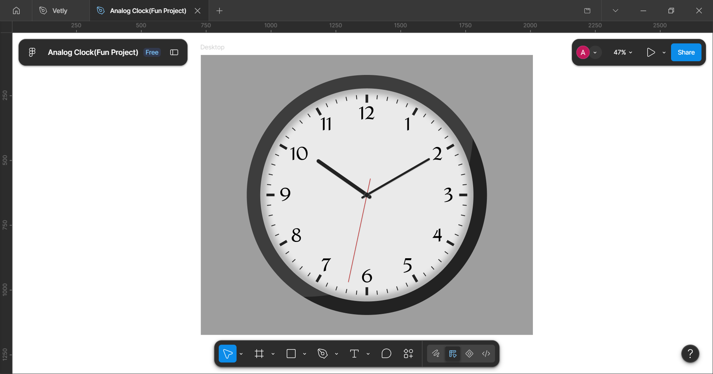

# Analog Clock

**Live demo:** https://ay-ux1.github.io/analog-clock/



A working analog clock built with plain HTML, CSS and vanilla JavaScript. No libraries, no images. It recreates a Figma design and shows the real current time.

**Design:** [View the Figma file](https://www.figma.com/design/GUIUyK4zfK9nyclr15noQ6/Analog-Clock-Fun-Project-?node-id=0-1)

## Features

- Shows the real time and updates every second
- Hour, minute and second hands that rotate around the exact center
- 60 ticks generated with JavaScript (every 5th tick is longer and thicker)
- Numbers 1 to 12 in the Amita font, always upright
- Soft inner shadow on the face and a light crescent on the bezel, as in the design
- Hands never spin backward when they pass 12
- Scales with one CSS variable and never overflows the screen

## Files

| File | What it does |
|---|---|
| `index.html` | The clock layers, from bottom to top |
| `style.css` | All colors and sizes, as CSS variables |
| `script.js` | Builds the ticks and numbers, and moves the hands |

## Run it

Open `index.html` in your browser. There is nothing to install. An internet connection is needed once to load the Amita font from Google Fonts.

## Customize

**Resize the clock.** Change `--clock-size` at the top of `style.css`. The default is `926px`, the size in Figma. Everything scales with it. On small screens the clock shrinks to fit.

```css
:root {
  --clock-size: 600px;
}
```

**Smooth second hand.** At the top of `script.js`, set `SMOOTH_SECOND_HAND` to `true`. With `false`, the second hand ticks once per second.

```js
const SMOOTH_SECOND_HAND = false;
```

**Change colors.** Every color is a variable in `style.css` (for example `--c-face`, `--c-second` and `--c-hand`).

## How it works

- **Scaling:** every size in `style.css` is written in Figma pixels and multiplied by `--u`, which is 1/926 of the clock's width. At 926 px, one design pixel equals one real pixel.
- **Angles:**
  - second = seconds × 6
  - minute = minutes × 6 + seconds × 0.1
  - hour = (hours % 12) × 30 + minutes × 0.5
- **No reverse spin:** each hand keeps counting full turns, so the angle goes from 354° to 360° instead of dropping back to 0°.
- **Hand shadows:** each hand sits inside a wrapper that does not rotate, so the shadow always falls the same way, like in Figma.

## Browser support

Any recent version of Chrome, Edge, Safari or Firefox. The code uses CSS container units and the CSS `sin()` and `cos()` functions.

## Credits

- Design: Ayobami
- Font: [Amita](https://fonts.google.com/specimen/Amita) by Google Fonts
- Contact: qoweeyayobami@gmail.com